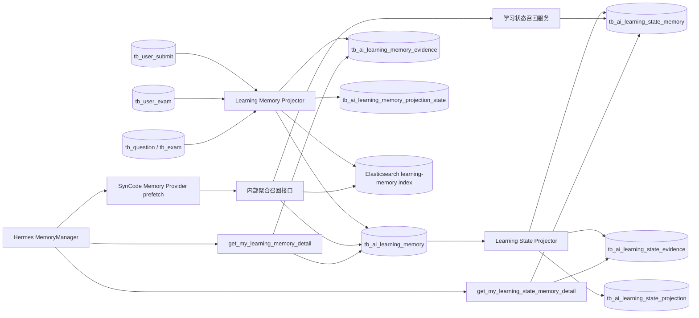

# Hermes 双域动态学习记忆架构

## 目标

SynCode 在 Hermes 原生记忆之外维护两个由 Hermes 核心召回自动加载、可追溯的业务记忆域：

- 做题记忆：一次提交或考试形成事件，连续尝试形成经历，多次经历形成错误模式。
- 学习状态记忆：按知识点维护当前掌握度、证据置信度、趋势和复习优先级。

原始业务表仍是事实源。学习记忆是可以重新生成的投影，不保存完整提交代码，也不替代 Hermes 原生记忆。

## 双记忆域

Hermes 原生记忆保存用户在对话中明确表达的目标、语言偏好和教学方式偏好。SynCode 做题记忆保存发生过的业务事实，学习状态记忆保存从做题经历动态计算的当前状态。

```text
Hermes 原生记忆：用户希望先得到提示，主要使用 Java，目标是准备校赛
SynCode 做题记忆：最近 90 天两次二分题经历出现答案错误，之后两次一次通过
SynCode 学习状态：二分查找掌握度 82，置信度 0.63，趋势 improving
Hermes Memory Provider：每轮按当前问题自动召回两个业务记忆域
Hermes Skill：使用已注入的记忆，并在必要时展开证据
```

动态能力判断不能永久写入 Hermes 原生记忆。发生冲突时采用以下事实优先级：

```text
学习事件 > 学习经历 > 学习模式 > 学习状态 > Hermes 历史文字总结
```

## 数据流



记忆在两种情况下更新：

1. Hermes 发起学习记忆召回前，系统同步当前用户的提交和考试数据，保证本轮读取新鲜。
2. 已启用的治理心跳按配置周期扫描所有有学习记录的用户，提前刷新记忆投影和索引。

每个用户的源数据指纹、三层做题记忆数量、学习状态数量和 Elasticsearch 索引指纹保存在各自投影状态表中。提交、考试、题目标签、难度和相关元数据没有变化时，召回不会重复重建；首次启用或重建搜索索引时，可以独立补齐索引。

## 投影规则

### 学习事件

每条最终提交生成一个 `submission` 事件。事件保存题目、标签、结果、得分、标准化错误类型、运行时间、内存和原始提交 ID，不保存 `user_code`。

每条用户考试关系生成一个 `exam_result` 事件，保存考试、分数、排名和关联正式提交统计。

### 学习经历

同一题目、同一考试范围内，相邻时间不超过 24 小时的提交合并成一次 `problem_episode`。经历保存：

- 提交次数和结果路径；
- 是否最终通过；
- 出现过的标准化错误类型；
- 第一次和最后一次提交时间；
- 支撑该经历的提交证据。

每次考试同时形成 `exam_episode`，用于复盘与训练规划。

### 学习模式

系统按知识标签和错误类型聚合最近 90 天的做题经历。至少两次独立经历出现同一组合时，才生成 `error_pattern`。

模式状态根据最后一次错误后的干净通过次数变化：

- `active`：仍需关注；
- `improving`：之后至少两次通过且未再出现该错误；
- `resolved`：之后至少五次通过且未再出现该错误；
- `superseded`：来源消失或已被新投影替代。

置信度由重复经历数和后续改善情况共同计算。模式保存支撑经历 ID，经历继续保存原始提交 ID，因此任何长期判断都可以向下追溯。

## 核心多层级召回

每个有实际语义的用户回合开始时，Hermes `MemoryManager` 自动调用 SynCode Memory Provider 的 `prefetch(query)`。Provider 使用当前 Profile 身份请求内部聚合接口；模型无需选择工具，也不能跳过这一步。内部接口执行等价的受限查询：

```text
learning_memory_service.recall(
    query,
    levels,
    knowledge_tags,
    time_range_days,
    pattern_limit,
    episode_limit,
    event_limit
)
```

返回固定的 `patterns`、`episodes` 和 `events` 三组结果。Provider 默认只取 2 条模式、4 条经历和 2 条事件，再根据结果中的知识标签加载最多 5 条学习状态，最终上下文限制为 7000 字符，避免把大量历史数据塞入上下文。

Elasticsearch 和 Embedding 可用时，每个层级分别执行：

1. 对 title、summary、knowledge tags 和 error type 做 BM25。
2. 对同一份摘要文本做 dense vector 检索。
3. 使用加权 RRF 融合两路排名。
4. 强制过滤当前用户哈希、记忆层级、时间范围、知识标签和非 superseded 状态。

Elasticsearch 不可用时，召回服务使用数据库中的结构化过滤、词项重合、时间衰减、置信度和状态权重完成降级召回，并明确返回 `retrieval_mode=database` 或 `database_fallback`。

需要核实某条已召回结果时，Hermes 才调用模型可见的只读详情工具：

```text
get_my_learning_memory_detail(memory_id)
```

详情工具再次按当前 Profile 用户过滤，并返回该记忆的结构化事实和证据列表。其他用户即使获得 memory ID 也无法读取。

## 学习状态记忆

学习状态按用户和知识标签唯一维护。系统从做题经历中计算：

- `mastery_score`：结合最终结果、提交次数、错误数量、题目难度和时间衰减得到表现分，再按证据置信度向中性基线收缩后的 0 到 100 分估计；
- `confidence`：由独立题目数和学习经历数计算的证据充分程度；
- `mastery_level`：`insufficient`、`foundational`、`developing`、`stable` 或 `proficient`；
- `trend`：比较近期与此前经历，得到 `improving`、`stable` 或 `declining`；
- `priority_score` 与 `next_review_at`：结合薄弱程度、遗忘风险、趋势和不确定性确定复习顺序。

`mastery_score` 不是考试分数，也不是模型自由生成的评价。每条状态最多保留最近 50 条做题经历证据，可以展开查看每次经历对结果的贡献。证据不足时即使一次通过得到较高分，也会标记为 `insufficient`，Hermes 必须同时说明置信度。

学习状态召回由同一个 Provider 聚合请求自动完成，内部调用：

```text
learning_state_service.recall(
    knowledge_tags,
    focus,  # weakest / review_due / improving / declining / all
    limit
)

```

`get_my_learning_state_memory_detail(state_id)` 仍作为模型可见的证据展开工具。两个原来的 `recall_*` MCP 工具不再暴露，避免把核心记忆能否加载交给模型的工具选择。

每次学习状态召回前会先同步做题记忆。新的正式提交、考试成绩或题目元数据变化会使源指纹变化，并在本次调用中重建受影响用户的两个记忆投影。学习状态指纹还包含评分模型版本和 UTC 日期，因此即使没有新提交，遗忘风险与复习到期状态也会每天至多重算一次。周期心跳提前刷新所有用户，召回前同步负责最终新鲜度。

Provider 的网络请求限制为 4 秒，Hermes 对外部 Provider 还有统一的 8 秒上限。内部服务或数据库失败时，Provider 本轮返回失败，`MemoryManager` 按非致命错误处理并继续使用 Hermes 原生记忆和当前上下文；只有成功注入时才显示确定性的记忆召回状态。该降级不会把过期业务状态伪装成新结果。

## Hermes Skill 编排

平台 Skill `syncode-learning-memory` 定义已召回记忆的使用边界：

- 当前错误诊断使用核心上下文中的做题经历和事件；
- 相似历史问题优先使用做题经历；
- 薄弱点和训练规划先使用学习状态，再按需展开具体错误模式的证据；
- 考试复盘使用考试经历和支撑事件；
- 推荐下一题结合学习状态、近期经历和当前训练计划。

`syncode-diagnosis`、`syncode-tutor` 和 `syncode-training-plan` 已接入双域记忆使用规则。用户无需手动指定工具或 Skill，也没有额外的自定义意图路由器。

## 隔离与数据最小化

- Memory Provider 和证据详情 MCP 都从 Hermes 注入的 `syncode-u<userId>` Profile 推导用户身份。
- 工具参数不接受 user ID，模型无法选择查询其他用户。
- MySQL 查询始终带当前 `user_id`。
- Elasticsearch 使用带服务端密钥的单向用户哈希过滤。
- 投影和索引不保存完整提交代码。
- 学习状态只能由当前用户的做题记忆生成，状态详情仍按当前 Profile 用户过滤。
- 返回内容带时间、状态、置信度和证据引用，不允许无依据扩展长期结论。

## 部署

先执行已有 Skill Registry 与 Skill Governance SQL，再执行：

```text
deploy/dev/sql/2026-10-14-hermes-learning-memory.sql
```

混合召回复用 Skill 治理的 Elasticsearch 和 Embedding 配置，并增加：

```text
SYNCODE_LEARNING_MEMORY_INDEX=syncode-learning-memory-v1
SYNCODE_LEARNING_MEMORY_MIN_RRF_SCORE=0.012
```

Embedding 未配置时，数据库召回仍然可用；配置后自动切换为 Elasticsearch 混合召回。

## 验收路径

1. 用户在两道同标签题目中出现相同错误并最终通过。
2. 用户随后在两道同标签题目中一次通过。
3. 向 Hermes 提交相关问题，确认 `MemoryManager` 在首个模型调用前自动注入 `improving` 模式、对应做题经历和提交事件。
4. 确认同一核心记忆上下文包含知识点掌握度、置信度、趋势和复习优先级，且没有发生 `recall_*` MCP 工具调用。
5. 分别展开模式和学习状态详情，确认状态能追溯到经历，经历能追溯到提交。
6. 修改题目难度或标签但不新增提交，确认下次加载会重新计算学习状态。
7. 使用另一用户的 Profile 请求相同 memory ID 或 state ID，确认读取失败。
8. 检查投影表和 Elasticsearch 文档，确认没有保存提交源码。
