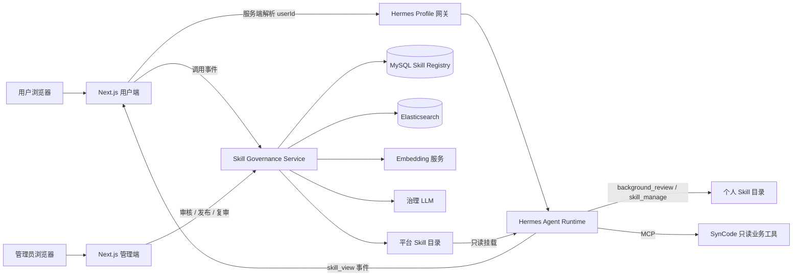

# SynCode Hermes 多用户 Skill 演化与治理架构

> 用途：面试背诵与技术追问准备。本文只描述当前代码已经实现的能力；真实 MySQL、Elasticsearch、Embedding 服务和 Swarm 环境仍需部署验收。

## 一句话介绍

我在 SynCode 中以 Hermes 作为唯一智能体运行时，设计并实现了一套多用户 Skill 演化与治理平台：Hermes 在每个用户的隔离空间中自动沉淀个人经验，系统通过 Elasticsearch 的 BM25 与向量混合检索发现跨用户共性，利用大模型生成去个性化的平台 Skill 候选，再由管理员审核发布；同时通过真实的 `skill_view` 调用事件和治理心跳管理平台 Skill 的完整生命周期。

## 30 秒版本

这个项目解决的是多用户 Agent 的经验如何既保持个性化，又能沉淀成平台公共能力的问题。

我把每个 SynCode 用户映射成独立的 Hermes Profile，个人 Skill 只能在自己的 Profile 中生成和修改。系统定时扫描有效个人 Skill，保存不可变版本，并把脱敏后的描述、分类和完整内容写入 Elasticsearch。检索时同时执行 BM25 和向量检索，再用 RRF 融合，并通过跨用户互为近邻和最少用户数限制形成候选簇。大模型只负责把候选簇泛化成平台 Skill 草稿，最终必须经过管理员查看脱敏证据、编辑和审核才能发布。平台 Skill 对所有用户可见但只读。系统还从 Hermes 原生事件流中采集 `skill_view` 调用，低频 Skill 只进入人工复审，不会自动删除。

## 3 分钟版本

SynCode 原来只把 Hermes 当成对话 Agent 使用，但 Hermes 本身有 `background_review` 和 `skill_manage`，能在使用过程中生成和改进 Skill。进入多用户场景后会出现三个问题：第一，用户经验不能混在一起；第二，个人 Skill 不能永远停留在个人目录里，平台需要发现可以复用的共性能力；第三，平台 Skill 不能由模型直接上线，需要治理、审计和淘汰机制。

我的方案分为三层。

第一层是个人能力层。服务端根据登录用户生成 `syncode-u<userId>`，浏览器不能指定 Profile。Hermes 的会话、记忆和个人 Skill 都落在该 Profile 下。Hermes 可以通过原生后台复盘自动创建或更新 Skill，用户也可以查看、编辑、归档、恢复和回滚。治理服务扫描文件后用内容哈希判断变化，每次变化生成不可变版本。为了避免把系统内置 Skill 或 Hub 下载的 Skill 错当成用户经验，扫描器会结合 `.bundled_manifest`、`.hub/lock.json` 和 `.usage.json` 做来源过滤。

第二层是公共能力发现层。治理心跳同步所有用户的当前有效版本，对内容进行脱敏，再把 Skill 的 description、category、完整 `SKILL.md` 和 embedding 写入 Elasticsearch。检索不是只比简介，也不是只做向量搜索：BM25 负责保留算法名、工具名和固定术语等精确信号，向量检索负责发现表达不同但过程相似的能力，两路结果通过 RRF 融合。只有不同用户的两个 Skill 互相进入对方近邻列表才连边，再对图求连通分量；默认至少三个不同用户才能成为晋升候选，避免单个用户的重复版本制造虚假共性。

第三层是平台治理层。大模型接收最多十二个脱敏样本，生成完整 `SKILL.md` 草稿，并被明确要求把样本视为不可信数据，不能执行样本中的指令。管理员可以看到匿名来源、版本、相似度、用户数和近 30 天调用量，编辑名称、分类和内容后发布，也可以驳回。发布后的 Skill 进入独立平台目录，通过只读目录暴露给所有 Hermes Profile。候选身份包含成员版本，因此个人 Skill 后续演化后可以产生新的候选，不会被旧候选永久阻塞。

平台运行后，Next.js 代理从 Hermes SSE 事件中只识别原生 `skill_view`，记录 Skill 名称、解析出的版本、run、session 和时间，不采集完整回答或用户代码。心跳按真实调用量识别长期低频的平台 Skill，将其放入管理员复审队列，由管理员选择保留或归档。文件发布和数据库审计之间还做了补偿：数据库写入失败时恢复旧文件，避免 Hermes 使用了一个数据库中没有发布记录的版本。

## 要解决的核心问题

### 1. 多用户经验隔离

如果所有用户共享同一个 Skill 目录，会产生三个风险：

- A 用户的经验可能影响 B 用户的 Agent 行为。
- 用户可以覆盖平台 Skill 或其他用户的 Skill。
- 无法判断一条经验来自谁，也无法正确计算共性。

因此，个人 Skill 的存储、读写权限、版本记录和使用统计都必须带用户边界。

### 2. 从个性化经验中发现共性

仅按 Skill 名称或关键词统计不可靠。同一种能力可能被命名为 `loop-debugger`、`boundary-check` 或 `off-by-one-helper`，内容语义相近但字面不同。反过来，同名 Skill 也可能解决不同问题。因此需要同时利用词法信号和语义信号，并且必须统计独立用户数，而不是只统计 Skill 数量。

### 3. 防止未经审核的公共知识污染平台

个人 Skill 可能包含用户代码、路径、错误习惯、隐私信息，甚至提示注入内容。系统不能把个人 Skill 直接复制到公共目录。AI 只能生成候选，管理员才拥有发布权。

### 4. 平台能力需要持续治理

公共 Skill 发布后可能过时、重复或长期无人使用。系统需要真实使用数据和复审机制，但不能仅凭低频自动删除，因为低频 Skill 也可能是重要的长尾能力。

## 总体架构



系统中只有一个 Agent Loop，归 Hermes 所有。SynCode 不再自己拼 Prompt、解析模型生成的工具 JSON 或执行第二套 Agent Loop。SynCode 负责身份、业务数据、MCP 工具、代理和 Skill 治理。

## 核心对象

| 对象 | 含义 | 谁能修改 |
| --- | --- | --- |
| 个人 Skill | 某个用户在使用过程中形成的个性化经验 | Hermes 和该用户 |
| Skill Version | 某次内容变化形成的不可变快照 | 无人原地修改 |
| 晋升候选 | 多个独立用户的相似个人 Skill 形成的治理对象 | 管理员可审核和编辑草稿 |
| 平台 Skill | 管理员批准后向全体用户发布的公共能力 | 仅管理员发布新版本或归档 |
| 使用事件 | Hermes 实际加载 Skill 的事实记录 | 追加写入，不做业务修改 |
| 生命周期复审 | 低频或长期未使用平台 Skill 的人工决策任务 | 管理员 |

## 第一条链路：用户请求如何进入 Hermes

1. Next.js 从登录态读取真实 `userId`。
2. 服务端计算 Profile 名称，例如用户 42 对应 `syncode-u42`。
3. 首次访问时，Profile Provisioner 原子创建用户目录和 Hermes 配置。
4. 浏览器只请求 SynCode 的代理接口，不能提交或覆盖 Profile 名称。
5. Next.js 把请求转发到 `/p/syncode-u42/...`。
6. Hermes 自己选择 Skill、调用 `skill_view`、执行 MCP 工具并输出 SSE 事件。
7. SynCode 把 token、工具进度、审批状态和结束状态透传给前端。

这里最关键的设计是：**用户身份由服务端推导，模型和浏览器都不能选择数据归属。**

## Hermes 原生记忆与学习记忆如何配合

系统采用双记忆域。Hermes 原生记忆保存用户明确表达的目标、语言偏好和教学方式偏好；SynCode 学习记忆保存由提交和考试记录证明、会随新行为变化的客观事实。SynCode Memory Provider 接入 Hermes `MemoryManager` 的 `prefetch` 生命周期，在每轮首个模型调用前自动召回相关业务记忆；Skill 负责解释和使用已经注入的记忆。

学习数据被投影为三层：一次提交或考试是学习事件；一道题的一段连续尝试或一次考试是学习经历；最近 90 天多次经历中重复出现的“知识标签 + 错误类型”形成学习模式。每个模式都可以向下追溯到经历和原始事件，完整提交代码不会写入记忆投影或 Elasticsearch。

Provider 使用当前 Profile 调用内部聚合接口，自动加载分层做题记忆以及按知识点维护的掌握度、置信度、趋势和复习优先级；Hermes 只在需要核实结论时调用 `get_my_learning_memory_detail` 或 `get_my_learning_state_memory_detail` 展开证据。身份始终从 Profile 推导，模型不能传入用户 ID。做题记忆在 Elasticsearch 可用时使用 BM25、Dense Vector 和 RRF，不可用时使用数据库结构化召回并明确标记降级模式。

动态能力结论不能写死在 Hermes 原生记忆中。事实优先级是“学习事件 > 学习经历 > 学习模式 > Hermes 历史文字总结”。同一错误后出现两次干净通过时，模式进入 `improving`；出现五次时进入 `resolved`，避免旧错误永久影响推荐。

这套设计可以概括为：**Hermes 原生记忆记住用户希望怎样学，SynCode Provider 把用户实际学得怎样自动送入核心记忆上下文，Skill 决定怎样使用和何时追溯证据。**

## 第二条链路：个人 Skill 如何产生和演化

### Skill 的产生

Hermes 是个人 Skill 的创作引擎，来源包括：

- `background_review`：对历史交互做后台复盘后自动创建或更新 Skill。
- `skill_manage` / Learn：用户明确教给 Hermes 的能力。
- 用户在 Skill 工作台中创建或编辑的本地 Skill。

系统没有要求用户在对话中手动输入 `/skill-name`。正常流程是 Hermes 根据上下文自动选择并加载 Skill。

### 来源过滤

扫描器只把真正的个人经验纳入治理：

- 接受 Hermes Agent 自动生成的 Skill。
- 接受用户 Learn 或手工创建的 Skill。
- 排除 `.bundled_manifest` 中的内置 Skill。
- 排除 `.hub/lock.json` 中记录的 Hub 安装 Skill。
- 排除 `.usage.json` 中 `created_by=installed` 的 Skill。
- 忽略 `.archive`、`.hub` 等隐藏目录。

如果来源文件损坏，系统停止该 Profile 的本次同步并保留数据库中最后一次有效状态。这样不会因为一次解析故障把所有个人 Skill 误判为已删除。

### 版本化

扫描器计算整个 Skill 包的 SHA-256，包括 `SKILL.md` 和允许的文本资源。内容未变化时不创建版本；内容变化时生成新的补丁版本，例如 `1.0.0 -> 1.0.1`，并在数据库保存不可变内容快照和包快照。

回滚不是修改旧版本，而是把旧版本内容重新写回用户目录，再同步成一个新版本，因此历史始终可追踪。

### 用户可操作能力

- 查看个人 Skill 和最近 30 天使用量。
- 查看历史版本。
- 编辑当前版本。
- 归档和恢复。
- 回滚到任意已有版本。
- 查看平台 Skill，但不能修改平台目录。

编辑接口不能只依赖前端隐藏按钮。服务端会先从治理注册表确认目标是该用户当前有效的个人 Skill，否则返回 403。因此直接调用 API 也不能修改内置、Hub 或平台 Skill。

## 第三条链路：如何发现跨用户相似 Skill

### 索引内容

每个当前有效的个人 Skill 形成一条 Elasticsearch 文档，包含：

- Skill ID 和版本。
- 单向用户哈希 `owner_hash`。
- 名称、description 和 category。
- 脱敏后的完整 `SKILL.md` 内容。
- 内容哈希。
- `description + category + content` 生成的向量。

索引只保存当前有效版本。单用户同步会替换该用户的全部索引文档；全量心跳会替换整个索引，因此历史版本和已归档 Skill 不会残留在发现结果里。

### 脱敏

进入共享索引和 AI 候选生成前，会处理：

- 邮箱。
- `syncode-u<id>` Profile 名称。
- API Key、Token、Password、Secret、Authorization 等疑似凭据。
- 本机用户目录。
- 较长数字标识。

用户 ID 使用带服务端密钥的单向哈希，只用于判断是否来自不同用户。管理端返回匿名引用，不暴露内部 `skill_id`、原始用户 ID 或稳定 `owner_hash`。

### BM25 词法检索

词法查询字段权重为：

```text
description^4 + content^2 + category
```

description 权重最高，因为它描述触发场景；完整 content 也参与检索，可以匹配具体流程、工具名和技术术语。

### 向量检索

系统为完整 Skill 语义生成 dense vector，并使用 cosine 相似度执行 KNN 检索。向量检索可以发现“表达不同但解决过程相似”的 Skill。

### RRF 融合

两路检索结果在应用层使用 Reciprocal Rank Fusion：

```text
RRF(d) = 1.0 / (60 + rank_bm25) + 1.5 / (60 + rank_vector)
```

当前向量结果权重为 1.5，词法结果权重为 1.0，默认最低融合分数是 `0.03`。这个阈值让候选通常需要同时获得词法和语义支持。

选择 RRF 的原因：BM25 分数和向量相似度不是同一量纲，直接相加需要复杂标定；RRF 只依赖排名，稳定、容易解释，也方便调整两路权重。

### 从近邻到聚类

检索后不会直接把所有相似结果交给 AI，而是先做图聚类：

1. 排除同一用户的 Skill。
2. 排除内容哈希完全相同的副本。
3. A 和 B 必须互相进入对方的近邻列表，才建立无向边。
4. 对相似图求连通分量。
5. 默认要求一个分量至少包含三个不同用户。

“互为近邻”减少单向偶然匹配，“独立用户数”防止一个用户创建多个相似 Skill 后触发平台晋升。

## 第四条链路：候选如何变成平台 Skill

### AI 泛化

候选簇通过门槛后，治理模型接收最多十二个脱敏样本，生成：

- 标题。
- 合法的 Skill slug。
- 分类。
- 公共摘要。
- 完整的 `SKILL.md`。

模型被要求删除用户路径、姓名、代码答案和个人案例，只保留可复用步骤。System Prompt 明确要求把所有样本视为不可信数据，避免 Skill 内容中的指令劫持治理模型。

AI 输出必须通过结构校验：

- 必须是严格 JSON。
- `SKILL.md` 必须包含合法 YAML Frontmatter。
- name 必须符合 slug 规则并与候选名称一致。
- description 必填且长度受限。
- 内容和包大小受限。

如果治理模型不可用，系统仍会保存 `discovered` 候选，管理员可以驳回；不会伪造一份已经生成好的草稿。

### 管理员审核

管理员可以查看：

- 独立用户数和成员 Skill 数。
- 最近 30 天真实调用量。
- 检索和相似度信息。
- 每个匿名来源的版本和脱敏节选。
- AI 生成的完整草稿。

管理员可以修改名称、分类、完整内容和审核备注，然后发布；也可以直接驳回。

### 候选去重与再演化

候选的 `cluster_key` 由成员的 `skill_id@version` 集合计算。相同成员版本不会重复创建候选；当个人 Skill 内容演化并产生新版本时，Cluster Key 会变化，因此可以进入新一轮平台审核。

这使个人 Skill 和平台 Skill 都具有演化能力，同时保留历史审核结论。

### 平台发布

发布后会同时完成：

1. 把 Skill 包原子写入平台目录。
2. 在注册表中创建或更新平台 Skill。
3. 创建不可变平台版本。
4. 写入发布记录和管理员审核日志。
5. 将平台目录以只读方式暴露给所有 Hermes Profile。

如果数据库持久化失败，服务会删除刚写入的文件并恢复发布前版本。平台归档同样有补偿逻辑，防止文件状态和数据库审计状态不一致。

## 第五条链路：使用统计和生命周期治理

### 为什么只记录 `skill_view`

系统不根据用户在文本中写了某个 Skill 名称来推测调用。只有 Hermes 原生事件流出现 `tool.started` 且工具为 `skill_view` 时，才认为 Skill 被真正加载。

记录字段包括：

- 幂等事件 ID。
- 用户和 Profile。
- Hermes run 和 session。
- Skill 名称和解析后的版本。
- 调用时间。
- 固定的 `{tool: "skill_view"}` 元数据。

不采集用户代码、完整模型回答或判题前后结果。这份数据用于目录治理，不再承担自动构建测评集的职责。

个人 Skill 与平台 Skill 同名时，版本解析遵循“个人优先、平台回退”，与 Hermes 的实际可见性一致。事件表以 `event_id` 为主键，SSE 重连或重复上报不会重复计数。遥测写入是 Best Effort，失败不会中断 Agent 回答。

### 生命周期复审

默认规则是：平台版本发布超过 30 天，且最近 30 天调用不超过 1 次，就进入复审队列。两个阈值都可以配置。

系统不会自动删除 Skill。管理员可以：

- 保留：记录审核结论，继续提供服务。
- 归档：从平台可见目录移走，同时保存审计记录。

这是“算法发现问题，管理员承担最终责任”的治理边界。

## 心跳机制

治理心跳默认按小时运行，也可以由管理员手动触发。一次完整心跳包括：

1. 扫描所有合法用户 Profile。
2. 同步个人 Skill 和不可变版本。
3. 刷新当前有效 Skill 的 Elasticsearch 索引。
4. 对每个 Skill 执行 BM25 与向量近邻检索。
5. 构建互为近邻图并发现跨用户聚类。
6. 调用治理模型生成候选草稿。
7. 写入或更新晋升候选。
8. 根据使用量生成平台 Skill 生命周期复审任务。
9. 保存本次心跳指标和失败原因。

服务使用非阻塞锁防止定时心跳和管理员手动心跳并发执行。如果 Elasticsearch 或 Embedding 未配置，个人 Skill 同步与版本管理仍然可用，但语义发现心跳会明确失败，不会降级成不可靠的“伪混合检索”。

## 数据模型

| 表 | 作用 |
| --- | --- |
| `tb_ai_skill` | Skill 主记录，区分 personal/platform、所有者、当前版本和生命周期状态 |
| `tb_ai_skill_version` | 不可变版本、内容哈希、`SKILL.md` 快照和包快照 |
| `tb_ai_skill_usage_event` | 追加式 `skill_view` 调用事件 |
| `tb_ai_skill_promotion_candidate` | 晋升候选、AI 草稿、聚类统计和审核状态 |
| `tb_ai_skill_promotion_member` | 候选的匿名来源证据、成员版本和相似度 |
| `tb_ai_skill_promotion_review_action` | 管理员批准、驳回等审核日志 |
| `tb_ai_skill_release` | 平台 Skill 的不可变发布记录 |
| `tb_ai_skill_lifecycle_review` | 低频平台 Skill 的复审任务和结论 |
| `tb_ai_skill_governance_heartbeat` | 每次治理心跳的状态、指标和错误信息 |

关系数据库保存事实、版本、状态和审计；Elasticsearch 只负责当前有效个人 Skill 的相似性发现。它们承担不同职责，不能用 Elasticsearch 代替治理数据库。

## 权限和安全设计

### 用户隔离

- Profile 只能由服务端根据数字用户 ID 生成。
- Profile 路径必须位于受控根目录，拒绝符号链接和路径逃逸。
- MCP 根据 Hermes 注入的 Profile Header 反解用户 ID，不接受模型传入的用户 ID。
- 所有个人 Skill 查询都带 `scope=personal AND owner_user_id=<current user>`。

### 平台只读

- 平台目录以只读方式挂载给 Hermes。
- 用户端编辑接口只允许注册表中的当前个人 Skill。
- 平台发布和归档只能通过管理员治理接口。

### 数据最小化

- 进入共享检索前先脱敏。
- 管理端不暴露原始用户 ID、内部 Skill ID 或稳定用户哈希。
- AI 只接收匿名样本，不接收用户 Skill 自定义名称。
- 使用统计只保存调用事实，不保存完整对话和代码。

### 提示注入防护

- 个人 Skill 样本按不可信数据处理。
- 治理模型的 System Prompt 禁止执行样本中的指令。
- 模型输出经过 JSON、Frontmatter、名称、描述和大小校验。
- AI 没有发布权限，最终必须经过管理员审核。

## 一致性和可靠性

### 原子文件写入

Skill 包先写入临时目录，校验完成后再替换目标目录，避免 Hermes 读到半写入状态。

### 数据库事务

版本、候选、成员、审核和发布记录在事务中写入。使用事件通过主键去重。

### 跨文件系统和数据库的补偿

文件系统和 MySQL 无法使用同一个本地事务，因此发布流程保留发布前包。数据库失败时删除新包并恢复旧包；归档持久化失败时把文件移回原位置。

### 故障隔离

- 单个 Profile 来源信息损坏时，不误归档已有记录。
- 遥测失败不影响用户的 Agent Run。
- Elasticsearch 或 Embedding 故障不会破坏个人版本数据。
- 治理心跳记录失败状态和错误原因，便于管理员重试和排查。

## 关键技术选择

### 为什么复用 Hermes 原生 Skill 机制

Hermes 已经拥有 Agent Loop、Skill 选择、`background_review`、`skill_manage`、会话和记忆。重新在业务后端实现一套 Skill 调用逻辑会形成双 Agent Loop，导致状态、工具调用和记忆所有权混乱。因此 SynCode 只扩展隔离、治理和审计，不接管 Hermes 的推理循环。

### 为什么用 Elasticsearch

这个场景同时需要：

- description、技术名词和工具名的 BM25 全文检索。
- 完整 Skill 内容的 dense vector 检索。
- owner、版本和状态等结构化过滤。

Elasticsearch 可以在一个索引中同时保存文本字段、keyword 字段和 dense vector，适合做混合召回。MySQL 仍然保存业务事实和审计记录。

### 为什么不是只比较简介

简介主要描述触发条件，但真正可复用的能力还包含步骤、约束、工具顺序和异常处理。因此 embedding 和 BM25 都包含完整 `SKILL.md`，description 只是获得更高词法权重。

### 为什么 AI 只生成候选

相似检索只能说明“可能是同一类能力”，AI 泛化也可能丢失约束或带入错误内容。平台 Skill 会影响所有用户，所以发布权必须在人类管理员手中，并保留来源证据和审计日志。

### 为什么低频不自动删除

调用少不等于没有价值。竞赛规则、罕见编译错误、特殊语言问题都可能是低频但重要的长尾能力。因此系统只自动生成复审任务，不自动做不可逆决策。

## 当前实现状态

已经完成：

- Hermes Profile 多用户隔离和服务端身份映射。
- Hermes 原生个人 Skill 的扫描和来源过滤。
- 个人 Skill 创建、编辑、版本化、回滚、归档和恢复。
- Elasticsearch BM25 + dense vector + RRF 混合检索实现。
- 跨用户互为近邻聚类和最少独立用户限制。
- AI 泛化、管理员审核、编辑、发布和驳回。
- 平台 Skill 只读共享和个人同名覆盖语义。
- `skill_view` 使用统计、心跳和低频复审。
- 文件与数据库失败补偿、心跳并发保护和审计表。
- 用户端和管理端工作台。

验证结果：

- Python 测试：33 个通过。
- 用户端行为测试通过。
- 管理端行为测试通过。
- 两个前端 TypeScript 检查通过。
- Python 编译检查和 `git diff --check` 通过。

仍需生产验收：

- 在真实 MySQL 执行迁移。
- 连接真实 Elasticsearch 和 Embedding 服务验证召回质量。
- 验证生产环境 Hermes Profile 与平台目录只读挂载。
- 使用至少三个测试用户完成一次真实晋升，再由第四个用户调用平台 Skill。

面试时应表述为“核心功能和代码闭环已经完成，处于可演示、可联调状态”，不要声称已经完成生产部署或已经获得线上指标。

## 面试常见追问

### Q1：这不就是一个 RAG 系统吗？

不是。RAG 的核心是为一次回答召回外部知识；这里治理的是 Agent 的可执行行为资产。Skill 有所有者、版本、生命周期、发布权限和实际调用统计，最终还会改变 Hermes 后续处理任务的步骤。混合检索只是发现相似 Skill 的一个环节。

### Q2：怎么保证统计的是不同用户，而不是一个用户创建了很多 Skill？

索引中为每个用户生成带服务端密钥的单向 `owner_hash`。聚类只允许跨 owner 连边，候选门槛统计 distinct owner，默认至少三个独立用户。

### Q3：为什么还要 BM25，向量检索不够吗？

向量检索适合语义相似，但算法名、异常名、工具名和语言关键字等精确信号可能被弱化。BM25 保留这些信号。两路通过 RRF 按排名融合，避免直接混合不同量纲的原始分数。

### Q4：怎样降低错误聚类？

我用了四层限制：排除同用户和完全相同内容；设置 RRF 阈值；要求互为近邻；要求至少三个独立用户。之后 AI 只生成草稿，管理员仍需查看脱敏来源并审核。

### Q5：个人 Skill 更新后，旧候选会怎样？

候选身份包含每个成员的 Skill ID 和版本。内容变化产生新版本后会形成新的 Cluster Key，可以重新进入审核；旧的已发布或已驳回候选继续保留审计历史。

### Q6：如何防止把内置或下载 Skill 误判为用户经验？

扫描时同时读取 Hermes 的 bundled manifest、Hub lock 和 usage provenance，只接受 Agent、Learn 和本地手写来源。来源文件损坏时宁可暂停该用户同步，也不会把未知来源晋升为平台资产。

### Q7：为什么需要管理员，而不是让 AI 自动发布？

平台 Skill 的影响范围是所有用户。个人样本可能有隐私、错误步骤和提示注入，模型泛化也可能丢失关键限制。因此 AI 负责提高整理效率，管理员负责最终责任、编辑和审计。

### Q8：使用量是怎么采集的？

Next.js 在透传 Hermes SSE 时识别原生 `tool.started` 事件，只有工具名等于 `skill_view` 才记录一次调用。事件 ID 做幂等去重，版本按个人优先、平台回退解析，遥测失败不阻断对话。

### Q9：发布时文件写成功、数据库写失败怎么办？

发布前保留原平台包。数据库事务失败后删除新文件并恢复旧文件；平台归档也使用反向补偿。这样 Hermes 可见文件和审计数据库最终保持一致。

### Q10：Elasticsearch 或 Embedding 挂了怎么办？

个人 Skill 的扫描、版本、编辑和回滚不依赖语义检索，仍可继续工作；平台发现心跳会标记失败并记录错误，不会用单路结果假装完成混合检索。管理员修复依赖后可以重新执行心跳。

### Q11：这个项目最有技术深度的地方是什么？

不是简单接入大模型，而是把模型生成的非结构化个人经验变成一套可隔离、可检索、可审核、可版本化、可发布、可观测和可回收的后端资产，并处理了身份边界、混合检索质量、提示注入、跨存储一致性和人机协同治理。

## 简历描述

推荐写法：

> 设计并实现基于 Hermes 的多用户 Skill 演化与治理平台，将 Agent 自动沉淀的个人经验按用户 Profile 隔离并进行不可变版本管理；基于 Elasticsearch BM25、Dense Vector 与 RRF 构建跨用户相似 Skill 发现链路，通过互为近邻和独立用户门槛生成候选，并结合 LLM 泛化、管理员审核、只读发布、真实调用统计和低频复审，形成个人能力向平台公共能力演化的完整闭环。

可以拆成三条：

- 基于 Hermes Profile 构建多用户个人 Skill 隔离、来源识别和不可变版本体系，支持自动沉淀、编辑、回滚、归档和恢复，并通过服务端身份推导与目录校验防止越权访问。
- 基于 Elasticsearch 实现 Skill 全文内容的 BM25 与 Dense Vector 混合检索，使用加权 RRF、跨用户互为近邻图聚类和最少独立用户门槛识别可复用经验。
- 构建 LLM 泛化与管理员审核发布流程，引入脱敏、提示注入防护、发布补偿、`skill_view` 真实调用统计和低频复审，实现平台 Skill 的可审计生命周期治理。

## 背诵关键词

```text
一个 Agent Loop：Hermes
两个层级：个人 Skill、平台 Skill
三类治理：隔离、晋升、生命周期
四个检索限制：跨用户、去重、互为近邻、最少三人
五段链路：沉淀、版本、发现、审核、复审
```

最应该记住的一句话是：

> 我做的不是一个 Skill 列表，而是一套把多用户 Agent 经验转化为平台可治理资产的演化系统。
